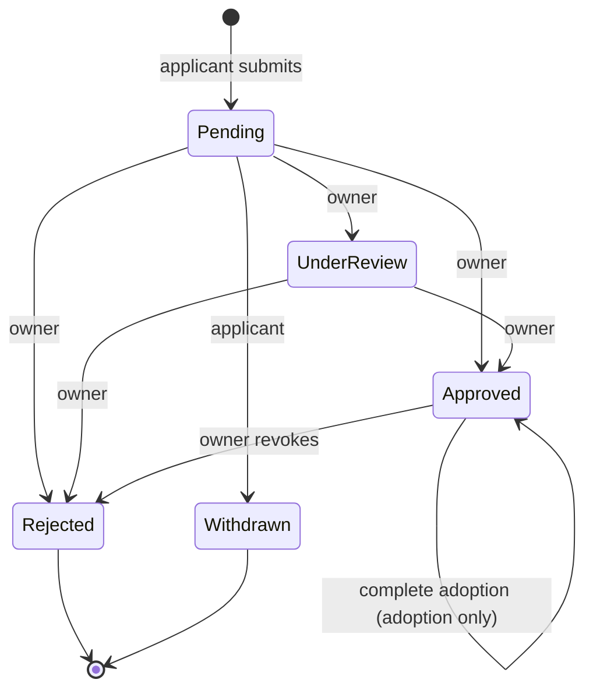
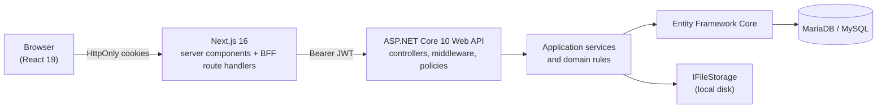
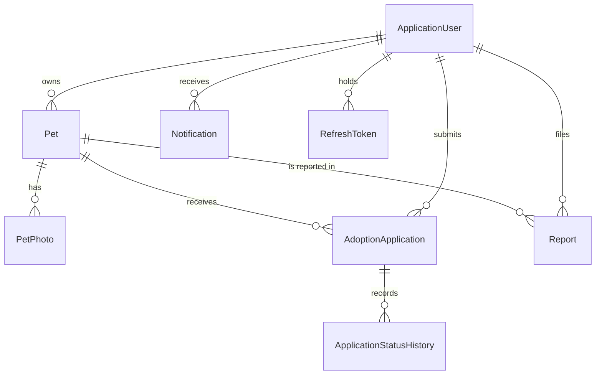

# 🐾 PawConnect

**A pet adoption and foster management platform that connects independent rescuers and small shelters with people who want to adopt or foster a pet.**

Rescuers publish pet profiles with photos, review applications and complete adoptions. Adopters browse, apply and track every application. Administrators moderate listings, handle reports and manage accounts. The app is a full-stack project: an **ASP.NET Core 10 Web API** with MariaDB/MySQL, and a **Next.js 16** frontend that talks to the API through a secure backend-for-frontend layer.

---

## Table of contents

1. [Overview](#1-overview)
2. [Tech stack](#2-tech-stack)
3. [Features by role](#3-features-by-role)
4. [How the main workflows work](#4-how-the-main-workflows-work)
5. [Architecture](#5-architecture)
6. [Security](#6-security)
7. [Data model](#7-data-model)
8. [API reference](#8-api-reference)
9. [Frontend routes](#9-frontend-routes)
10. [Getting started](#10-getting-started)
11. [Configuration](#11-configuration)
12. [Database and migrations](#12-database-and-migrations)
13. [Demo data and demo accounts](#13-demo-data-and-demo-accounts)
14. [Testing](#14-testing)
15. [Troubleshooting](#15-troubleshooting)
16. [Known limitations and roadmap](#16-known-limitations-and-roadmap)
17. [Screenshots](#17-screenshots)
18. [Deployment](#18-deployment)
19. [Author and license](#19-author-and-license)

---

## 1. Overview

PawConnect has four kinds of users:

| Role | In one sentence |
|---|---|
| **Guest** | Browses and searches pets, reads details, and can register or sign in. |
| **Adopter** | Applies to adopt or foster, tracks applications, and gets notified of every decision. |
| **Rescuer** | Lists pets, manages photos, reviews applications, and completes adoptions. |
| **Administrator** | Moderates listings, reviews reports, and manages accounts. |

Highlights:

- **Searchable, shareable browsing.** Server-side filtering, sorting and pagination, with every filter stored in the URL so searches can be bookmarked.
- **A real application workflow.** Adoption and foster applications move through an explicit state machine with a full status history, versioned decisions, duplicate prevention enforced by the database, and an explicit "complete adoption" step.
- **Secure by design.** HttpOnly cookie sessions through a BFF, short-lived JWTs, rotating refresh tokens with reuse detection, role policies, ownership checks, rate limiting, and validated file uploads.
- **Moderation built in.** Users can report listings. Admins review reports, suspend or archive listings with a note, and everyone affected is notified in the same database transaction.
- **Tested.** Unit tests for the domain rules and security helpers, plus integration tests that run the real API against a real database, including concurrency tests.

---

## 2. Tech stack

### Backend

| Area | Technology |
|---|---|
| Framework | ASP.NET Core Web API on **.NET 10 (LTS)**, C# |
| Database | **MariaDB / MySQL** (developed against MariaDB from XAMPP) |
| ORM | **Entity Framework Core 10** with migrations, via the `Microting.EntityFrameworkCore.MySql` provider |
| Authentication | **ASP.NET Core Identity** (`AddIdentityCore`), **JWT bearer** access tokens, rotating **refresh tokens** |
| Authorization | Role-based policies plus resource ownership checks in services |
| Validation | Data annotations and `IValidatableObject`, plus domain rules |
| Errors | `IExceptionHandler` with RFC 9457 **ProblemDetails** responses |
| Rate limiting | Built-in ASP.NET Core rate limiter (fixed window) |
| API docs | Built-in OpenAPI document with **Swagger UI** (Development only) |
| Logging | `ILogger` structured logging with `AUDIT:` lines for important actions |
| File storage | `IFileStorage` abstraction with a local-disk implementation |

### Frontend

| Area | Technology |
|---|---|
| Framework | **Next.js 16** (App Router), **React 19**, **TypeScript** |
| Styling | **Tailwind CSS 4** |
| Data fetching | **TanStack Query v5** in client components, direct server fetches in server components |
| Forms and validation | **React Hook Form** with **Zod 4** (`@hookform/resolvers`) |
| UI feedback | **Sonner** toasts, native `<dialog>` for confirmations, loading skeletons, empty and error states |
| Auth layer | Backend-for-frontend route handlers with **HttpOnly cookies** |

### Testing and tooling

| Area | Technology |
|---|---|
| Test framework | **xUnit v3** on the Microsoft Testing Platform |
| Integration tests | `Microsoft.AspNetCore.Mvc.Testing` (`WebApplicationFactory`) against a separate real database |
| Tools | Git, .NET SDK 10, Node.js 20.9+, XAMPP (MariaDB + phpMyAdmin), Swagger UI, Postman (optional) |

---

## 3. Features by role

### 3.1 Guest (not signed in)

- Browse available pets on the home page and on `/pets`.
- Search by name, breed or keyword, and filter by species, size, age range, adoption or foster availability, city, and vaccination status.
- Sort (newest, oldest, youngest, oldest pets, name) and paginate, with the filters kept in the URL.
- View a pet's detail page: photo gallery, health and care information, location, the rescuer's display name, and the adoption or foster options.
- Register and sign in. Applying requires an account.

### 3.2 Adopter

- Manage the profile: change the display name and the password (changing the password signs out all other devices).
- Submit an **adoption** or **foster** application for any published pet that accepts that type. Foster applications include a start date and duration.
- See all of your applications with filters by status and type, open any application, and read the **status history** with the rescuer's notes.
- **Withdraw** an application while it is still pending, and apply again later.
- Receive **in-app notifications** when a status changes or an adoption is completed (a bell in the navigation, plus a notifications page).
- **Report** a listing that looks wrong or unsafe.
- Applicant dashboard with totals, active applications, and recent activity.

### 3.3 Rescuer

- Create, edit, **publish**, **pause** and **archive** your own listings. New listings start as private drafts.
- Upload and manage **photos** (JPEG, PNG or WebP, up to 5 MB each, up to 8 per listing), choose the cover photo, and delete photos.
- See all applications for your pets, with filters by status, pet and type.
- Review an application: see the applicant's answers and the full history, **start review**, **approve**, **reject** (a note is required), or **revoke an approval**.
- **Complete an adoption**: the pet becomes Adopted, every other open application for that pet is rejected automatically, and everyone is notified.
- Rescuer dashboard with listing and application statistics, adoptions ready to complete, and a list of applications that need attention.
- Receive notifications for new applications and withdrawals, and see when a listing is suspended by a moderator and why.

### 3.4 Administrator

- Admin dashboard with statistics for users, listings, applications and open reports.
- **Report queue**: open reports come first. Review a report as *Resolved* or *Dismissed*, optionally suspending or archiving the listing, always with a note. Other open reports about the same listing are closed together with it.
- **Listing moderation**: search every listing (including drafts and suspended ones), then **suspend**, **restore** or **archive** with a note. The owner is notified and sees the reason.
- **User management**: search users by name, email, role or status, and **disable** or **reactivate** accounts (a disabled user is signed out immediately). Admins cannot disable themselves.
- Remove inappropriate photos from any listing.

### 3.5 What each role can do

| Capability | Guest | Adopter | Rescuer | Admin |
|---|:---:|:---:|:---:|:---:|
| Browse, search and filter published pets | ✅ | ✅ | ✅ | ✅ |
| View pet details and photos | ✅ | ✅ | ✅ | ✅ |
| Register and sign in | ✅ | – | – | – |
| Edit own profile and change password | ❌ | ✅ | ✅ | ✅ |
| Notifications and the notification bell | ❌ | ✅ | ✅ | ✅ |
| Submit adoption or foster applications | ❌ | ✅ | ❌ | ❌ |
| View own applications, history, withdraw | ❌ | ✅ | ❌ | ❌ |
| Create, edit, publish, pause and archive listings | ❌ | ❌ | ✅ own | ❌ |
| Upload, reorder cover and delete photos | ❌ | ❌ | ✅ own | ✅ any |
| Review applications and complete adoptions | ❌ | ❌ | ✅ own pets | ❌ |
| Read an application's answers | ❌ | ✅ own | ✅ own pets | ❌ |
| Report a listing (not your own) | ❌ | ✅ | ✅ | ✅ |
| Review reports and moderate listings | ❌ | ❌ | ❌ | ✅ |
| Disable or reactivate accounts | ❌ | ❌ | ❌ | ✅ |
| Dashboard | – | applicant | rescuer | admin |

> **Notes.** Hidden resources (other people's drafts, archived or suspended listings, other people's applications) return `404` rather than `403`, so their existence isn't revealed. Administrators deliberately **cannot** read application answers or edit listing content, because personal data is limited to the people who need it.

---

## 4. How the main workflows work

### 4.1 Listing lifecycle

```
Draft ──publish──▶ Available ──pause──▶ Unavailable
  ▲                   │  ▲                  │
  └───────────────────┘  └──publish─────────┘
Available / Unavailable ──complete adoption──▶ Adopted
Any live listing ──archive──▶ Archived
```

- Only the owner changes a listing's availability or archives it.
- **Suspended** is a separate moderation flag. A suspended listing is hidden from the public, and its owner cannot publish it again until an admin restores it.
- Archiving a listing rejects its open applications and notifies the applicants, in one transaction. A completed adoption is never touched.

### 4.2 Application lifecycle



Rules enforced by the server:

- The applicant may only **withdraw a pending** application.
- Rejecting requires a **note**, and the applicant can read it in the history.
- **Only one application can be approved per pet.** This is guaranteed by a unique database index, so two simultaneous approvals cannot both win.
- Every decision carries the **version** the rescuer last saw. If someone else changed the application in the meantime, the request returns `409` and the page refreshes.
- Approving a **foster** application never marks the pet as adopted. **Completing an adoption** is a separate, explicit step that works only for adoption applications.
- A user can have only **one active application per pet** (database-enforced). Withdrawn and rejected applications don't block a new one.
- Every change writes a **status history** entry (who, when, from, to, note) and the notifications **in the same transaction** as the change.

### 4.3 Moderation

Any signed-in user can report a published listing they don't own (one open report per user and listing, at most 5 reports per hour). An admin reviews the report and may resolve it with *suspend* or *archive*. The listing's owner is told the reason. Reporters are only told that the report was reviewed, never the internal note.

---

## 5. Architecture



| Layer | Responsibility |
|---|---|
| **Next.js (server components)** | Renders public pages (`/`, `/pets`, `/pets/[id]`) by calling the API directly, so content is in the first HTML response. |
| **Next.js BFF route handlers** | `/api/auth/*` and `/api/bff/*`. Store tokens in HttpOnly cookies, add the bearer header, refresh expired sessions, check `Origin` for CSRF, and allow-list which API routes the browser may reach. |
| **Controllers** | HTTP only: bind the request, call a service, return the response. No business logic. |
| **Application services** | Business logic, ownership checks, transactions, notifications. |
| **Domain (entities)** | Rules that belong to the data: status transitions, suspension locks, versioning. |
| **EF Core + MariaDB** | Persistence, unique indexes, foreign keys, concurrency tokens. |

### Folder structure

```
PawConnect/
├── PawConnect.slnx
├── global.json                      # runs `dotnet test` on the Microsoft Testing Platform
├── PawConnect.Api/                  # backend
│   ├── Controllers/
│   ├── Application/
│   │   ├── DTOs/                    # request and response contracts (never entities)
│   │   ├── Interfaces/
│   │   ├── Mapping/
│   │   └── Services/
│   ├── Domain/
│   │   ├── Entities/
│   │   ├── Enums/
│   │   └── Exceptions/
│   ├── Infrastructure/
│   │   ├── Data/                    # DbContext, configurations, migrations, demo seeding
│   │   ├── FileStorage/
│   │   ├── Identity/                # JWT options, token service, policies, seeder
│   │   └── OpenApi/
│   ├── Middleware/                  # global exception handler
│   └── Program.cs
├── PawConnect.Tests/                # unit + integration tests (xUnit v3)
├── pawconnect-web/                  # Next.js frontend
│   └── src/
│       ├── app/                     # routes, layouts, BFF route handlers
│       ├── components/
│       ├── hooks/
│       ├── lib/                     # api client, validation schemas, server helpers
│       ├── services/
│       └── types/
├── scripts/preflight.sh             # checks everything the app needs before you run it
├── docs/manual-testing-checklist.md
└── storage/                         # uploaded photos (git-ignored)
```

The API is a single project with folders named after the layers, so it can be split into separate projects later by moving folders.

### Key design decisions

- **BFF with HttpOnly cookies.** JavaScript in the browser never sees a token, so an XSS bug cannot steal a session. The API stays a stateless JWT bearer API (usable from Swagger or Postman), and needs no CORS because the browser never calls it directly.
- **Rules live in the domain.** Status changes go through methods like `ChangeStatus` and `Suspend`, so every code path (API, seeder, tests) obeys the same rules.
- **The database enforces invariants.** Unique indexes with `NULL` "slot" columns guarantee one active application per pet and user, one approved application per pet, and one open report per user and pet. Concurrency tokens detect stale writes.
- **Notifications are written transactionally.** A notification is saved in the same transaction as the change that caused it, so users never see a notification for something that was rolled back.
- **DTOs everywhere.** Entities are never exposed, and a reflection test fails the build if one is.
- **Real database in tests.** In-memory fakes can't reproduce unique indexes, concurrency or MySQL error codes, so integration tests use a real MariaDB.

---

## 6. Security

| Topic | What PawConnect does |
|---|---|
| **Passwords** | Hashed by ASP.NET Core Identity (PBKDF2). Minimum 10 characters with upper case, lower case and a digit. Maximum 128, so hashing can't be abused. |
| **Lockout** | 5 failed logins lock the account for 15 minutes. Login errors are generic ("Invalid email or password"). |
| **Sessions** | 15-minute JWT access tokens. 14-day refresh tokens stored **hashed** (SHA-256), **rotated** on every use, with **reuse detection** (a replayed token revokes the whole session family) and an atomic claim that stops two simultaneous refreshes. |
| **Per-request account check** | Every authenticated request verifies that the account still exists and is active, so a disabled account stops working immediately. |
| **Authorization** | Role policies on endpoints, plus ownership checks in services. Roles and ids come from the validated token, never from the request body. Roles cannot be self-assigned (registration accepts only Adopter or Rescuer). |
| **Information hiding** | Unauthorized access to private resources returns `404`, not `403`. |
| **Browser security** | HttpOnly, `SameSite=Lax` cookies. CSRF protection by checking the `Origin` and `Sec-Fetch-Site` headers on every state-changing request. The BFF proxy only forwards an allow-list of API routes and never forwards token-issuing routes. |
| **Rate limiting** | Auth endpoints: 10 per minute per client. Application submissions: 10 per hour per user. Reports: 5 per hour per user. Responses include `Retry-After`. |
| **Uploads** | Content type is decided by the file's **signature** (JPEG, PNG, WebP), not by the client's name or type. 5 MB limit, 8 photos per listing. Files are stored under random names outside any public folder, and served only through a controller that applies `X-Content-Type-Options: nosniff` and a sandboxing Content-Security-Policy. Path traversal is blocked. |
| **Input and output** | Request DTOs with validation. Response DTOs only. Over-posting is impossible because DTOs omit server-owned fields. EF Core parameterizes all queries. |
| **Errors** | RFC 9457 ProblemDetails. Unexpected errors return a generic message (the real cause is shown only in the Development environment and always logged on the server). |
| **Secrets** | Never committed. Development uses .NET user secrets and `.env.local`. Production uses environment variables. |
| **Audit** | Important actions (status changes, moderation, password changes, archiving) write `AUDIT:` log lines with the actor and target. |
| **Data minimization** | Application forms collect only what is needed. Admin views show display names and aggregates, and application answers are visible only to the applicant and the pet's owner. |

---

## 7. Data model



| Entity | Purpose |
|---|---|
| `ApplicationUser` / `ApplicationRole` | Identity users (GUID ids) and the roles Adopter, Rescuer, Admin. Users have a display name and an account status (Active or Disabled). |
| `Pet` | A listing: species, breed, age in months, size, sex, description, health and care information, availability (Adoption, Foster or Both), requirements, city and area, listing status, owner, suspension flag and note. |
| `PetPhoto` | Photo metadata (stored file name, type, size, cover flag). The files live in the storage folder. |
| `AdoptionApplication` | One adoption or foster application: answers, foster dates, status, version, uniqueness slots, completion time. |
| `ApplicationStatusHistory` | Append-only log of every status change: who, when, from, to, note. |
| `Notification` | An in-app notification for one user, with links to the application or pet. |
| `Report` | A user's report about a listing, with its review outcome. |
| `RefreshToken` | Hashed refresh tokens grouped into session families. |

Deletion rules: users and pets that have applications cannot be deleted (foreign keys restrict it), so history is never lost. Photos and application history cascade from their parent.

---

## 8. API reference

Base URL in development: `https://localhost:7227`. Interactive documentation (Development only): `https://localhost:7227/swagger`. Authenticated endpoints expect `Authorization: Bearer <access token>`.

List endpoints return a paged result: `items`, `page`, `pageSize`, `totalCount`, `totalPages`, `hasNext`, `hasPrevious`. Errors are ProblemDetails JSON. Validation errors add an `errors` object keyed by field.

### Authentication and account

| Method and route | Access | Purpose |
|---|---|---|
| `POST /api/auth/register` | Public | Create an Adopter or Rescuer account. Returns tokens. |
| `POST /api/auth/login` | Public | Sign in. Returns tokens. |
| `POST /api/auth/refresh` | Public | Exchange a refresh token for a new pair (rotation). |
| `POST /api/auth/logout` | Public | Revoke the session of a refresh token (idempotent). |
| `GET /api/auth/me` | Signed in | The current user. |
| `PATCH /api/account/profile` | Signed in | Change the display name. |
| `POST /api/account/change-password` | Signed in | Change the password. Revokes every session and returns a new one. |

### Pets and photos

| Method and route | Access | Purpose |
|---|---|---|
| `GET /api/pets` | Public | Search published pets (`q`, `species`, `size`, `minAgeMonths`, `maxAgeMonths`, `availabilityType`, `city`, `vaccinated`, `sort`, `page`, `pageSize`). |
| `GET /api/pets/{id}` | Public | Pet details. Drafts, archived and suspended listings are visible only to the owner and admins. |
| `GET /api/pets/mine` | Rescuer | Your listings, including drafts and archived ones. |
| `POST /api/pets` | Rescuer | Create a listing (saved as a draft). |
| `PUT /api/pets/{id}` | Rescuer (owner) | Update a listing. |
| `PATCH /api/pets/{id}/availability` | Rescuer (owner) | Publish, pause or set back to draft. |
| `DELETE /api/pets/{id}` | Rescuer (owner) | Archive a listing (soft delete). |
| `GET /api/pets/{petId}/photos` | Public | Photo metadata. |
| `GET /api/pets/{petId}/photos/{photoId}` | Public | The image file (same visibility rules as the pet). |
| `POST /api/pets/{petId}/photos` | Rescuer (owner), Admin | Upload one image as multipart field `file`. |
| `PATCH /api/pets/{petId}/photos/{photoId}/primary` | Rescuer (owner), Admin | Choose the cover photo. |
| `DELETE /api/pets/{petId}/photos/{photoId}` | Rescuer (owner), Admin | Delete a photo. |

### Applications

| Method and route | Access | Purpose |
|---|---|---|
| `POST /api/applications` | Adopter | Submit an adoption or foster application. |
| `GET /api/applications/my` | Adopter | Your applications (filter by `status` and `type`). |
| `GET /api/applications/incoming` | Rescuer | Applications for your pets (`status`, `type`, `petId`). |
| `GET /api/pets/{petId}/applications` | Rescuer (owner) | Applications for one of your pets. |
| `GET /api/applications/{id}` | Applicant or pet owner | One application with its history. |
| `PATCH /api/applications/{id}/status` | Rescuer (owner) | Review, approve or reject. Body needs the current `version`. |
| `POST /api/applications/{id}/complete-adoption` | Rescuer (owner) | Complete an approved adoption. |
| `POST /api/applications/{id}/withdraw` | Adopter (applicant) | Withdraw a pending application. |

### Notifications, reports and dashboards

| Method and route | Access | Purpose |
|---|---|---|
| `GET /api/notifications` | Signed in | Your notifications (`unreadOnly`, paging). |
| `GET /api/notifications/unread-count` | Signed in | Count for the navigation badge. |
| `PATCH /api/notifications/{id}/read` | Signed in | Mark one as read. |
| `POST /api/notifications/read-all` | Signed in | Mark all as read. |
| `POST /api/pets/{petId}/reports` | Signed in | Report a listing. |
| `GET /api/dashboard/applicant` | Adopter | Applicant statistics. |
| `GET /api/dashboard/rescuer` | Rescuer | Rescuer statistics. |
| `GET /api/dashboard/admin` | Admin | Platform statistics. |

### Administration

| Method and route | Access | Purpose |
|---|---|---|
| `GET /api/admin/users` | Admin | Search users (`q`, `role`, `status`). |
| `PATCH /api/admin/users/{id}/status` | Admin | Disable or reactivate an account. |
| `GET /api/admin/pets` | Admin | All listings, with moderation filters. |
| `PATCH /api/admin/pets/{id}/moderation` | Admin | Suspend, restore or archive, with a note. |
| `GET /api/admin/reports` | Admin | The report queue. |
| `GET /api/admin/reports/{id}` | Admin | One report with context. |
| `PATCH /api/admin/reports/{id}` | Admin | Resolve or dismiss, optionally with an action and a note. |

### Health

| Method and route | Access | Purpose |
|---|---|---|
| `GET /api/health`, `/api/health/version`, `/api/health/db` | Public | Liveness, version, and database connectivity (no data is exposed). |

### Example: submit an adoption application

```http
POST /api/applications
Authorization: Bearer eyJ...
Content-Type: application/json

{
  "petId": 12,
  "type": "Adoption",
  "livingArrangement": "House",
  "householdInfo": "Two adults and one child, aged 9.",
  "carePlan": "Someone is home most of the day. Daily walks and regular vet visits.",
  "reasonForApplying": "We would love to give Buddy a loving home."
}
```

`201 Created` returns the application with `"status": "Pending"`, `"version": 0` and one history entry.

---

## 9. Frontend routes

| Route | Access | Page |
|---|---|---|
| `/` | Public | Landing page with recently listed pets |
| `/pets` | Public | Browse with filters, search, sorting and pagination (all in the URL) |
| `/pets/[id]` | Public | Pet details, gallery, apply buttons, report button |
| `/pets/[id]/apply` | Adopter | Adoption or foster application form |
| `/login`, `/register` | Public | Authentication (demo logins in development) |
| `/dashboard` | Signed in | Redirects to the right home for your role |
| `/dashboard/profile` | Signed in | Display name and password |
| `/dashboard/notifications` | Signed in | Notification list |
| `/dashboard/my-applications`, `/dashboard/my-applications/[id]` | Adopter | Applications and details with history |
| `/dashboard/rescuer` | Rescuer | Overview and statistics |
| `/dashboard/rescuer/pets`, `/new`, `/[id]/edit` | Rescuer | Listings, create, edit and photos |
| `/dashboard/rescuer/applications`, `/[id]` | Rescuer | Incoming applications and the review page |
| `/dashboard/admin` | Admin | Overview and statistics |
| `/dashboard/admin/reports`, `/reports/[id]` | Admin | Report queue and review |
| `/dashboard/admin/pets` | Admin | Listing moderation |
| `/dashboard/admin/users` | Admin | User management |

Route protection in the frontend is a usability feature only. Every real permission check happens in the API.

---

## 10. Getting started

### Prerequisites

| Tool | Version |
|---|---|
| .NET SDK | 10 |
| Node.js | 20.9 or newer (22 or 24 LTS recommended) |
| MariaDB / MySQL | XAMPP's MariaDB works (the code targets 10.4 by default) |
| Git | any recent version |

On Windows, use **Git Bash** for the commands below.

### 1. Clone and create the database

Start MySQL in the XAMPP Control Panel, open `http://localhost/phpmyadmin`, go to the **SQL** tab, and run (choose your own password):

```sql
CREATE DATABASE IF NOT EXISTS paw_connect CHARACTER SET utf8mb4 COLLATE utf8mb4_unicode_ci;
CREATE USER IF NOT EXISTS 'pawconnect_user'@'localhost' IDENTIFIED BY 'Paw_Dev_2026_x7';
GRANT ALL PRIVILEGES ON paw_connect.* TO 'pawconnect_user'@'localhost';
FLUSH PRIVILEGES;
SELECT VERSION();
```

If `SELECT VERSION();` shows something other than 10.4.x, change `new Version(10, 4, 32)` in `PawConnect.Api/Program.cs` (and in `PawConnect.Tests/Integration/TestSettings.cs`) to match.

### 2. Configure the API secrets

Secrets stay out of Git. From the repository root:

```bash
dotnet user-secrets init --project PawConnect.Api
dotnet user-secrets set 'ConnectionStrings:DefaultConnection' 'Server=localhost;Port=3306;Database=paw_connect;User=pawconnect_user;Password=Paw_Dev_2026_x7;' --project PawConnect.Api
dotnet user-secrets set 'Jwt:SigningKey' "$(head -c 48 /dev/urandom | base64 | tr -d '\n')" --project PawConnect.Api
```

### 3. Create the tables

```bash
dotnet ef database update --project PawConnect.Api
```

If `dotnet ef` isn't installed: `dotnet tool install --global dotnet-ef --version "10.*"`.

### 4. Configure the web app

```bash
cd pawconnect-web
cp .env.example .env.local
npm install
mkdir -p certs
dotnet dev-certs https --trust
dotnet dev-certs https --export-path certs/aspnet-dev.pem --format Pem
cd ..
```

The exported certificate lets the Next.js server trust the API's development HTTPS certificate. Never disable TLS verification.

### 5. Check your setup (recommended)

```bash
bash scripts/preflight.sh
```

It prints `[ok]` or `[FAIL]` for every requirement (database server, secrets, correct database, build, migrations, type check) and tells you what to fix.

### 6. Run

Terminal 1, the API:

```bash
dotnet run --project PawConnect.Api --launch-profile https
```

Look for `Demo data is ready` in the log. API: `https://localhost:7227`. Swagger: `https://localhost:7227/swagger`.

Terminal 2, the web app:

```bash
cd pawconnect-web
npm run dev
```

Open **http://localhost:3000**, go to **Sign in**, and use the one-click **Demo accounts** buttons.

---

## 11. Configuration

### API (`PawConnect.Api`)

Set with .NET user secrets in development, or environment variables in production (use `__` instead of `:`, for example `Jwt__SigningKey`).

| Setting | Required | Purpose |
|---|:---:|---|
| `ConnectionStrings:DefaultConnection` | ✅ | Database connection string. |
| `Jwt:SigningKey` | ✅ | JWT signing secret, at least 32 characters. |
| `Jwt:Issuer`, `Jwt:Audience` | – | Defaults in `appsettings.json` (`PawConnect.Api`, `PawConnect.Web`). |
| `Jwt:AccessTokenMinutes`, `Jwt:RefreshTokenDays` | – | Token lifetimes (default 15 minutes and 14 days). |
| `Seed:AdminEmail`, `Seed:AdminPassword` | – | Creates an administrator on startup when both are set. |
| `Seed:DemoData` | – | Set to `false` to disable demo data (Development only feature). |
| `Seed:DemoPassword` | – | Overrides the demo account password. |
| `Storage:RootPath` | – | Where photos are stored. Defaults to `storage/pet-photos` next to the API project. |
| `RateLimiting:Auth|Submit|Report:PermitLimit` and `:WindowMinutes` | – | Rate limit overrides. |
| `ASPNETCORE_ENVIRONMENT` | – | `Development` enables Swagger and demo data. |

### Web app (`pawconnect-web/.env.local`)

| Variable | Purpose |
|---|---|
| `API_BASE_URL` | The API's base URL (server-side only, never sent to the browser). |
| `APP_ORIGIN` | The exact origin users open in the browser, for example `http://localhost:3000`. It must match exactly, or state-changing requests are rejected as cross-site. |

`.env.example` lists the variables with safe placeholders. `NODE_EXTRA_CA_CERTS` is set by the `npm run dev` script and points at the exported development certificate.

---

## 12. Database and migrations

```bash
dotnet ef migrations add <Name> --project PawConnect.Api --output-dir Infrastructure/Data/Migrations
dotnet ef database update --project PawConnect.Api
dotnet ef migrations list --project PawConnect.Api
dotnet ef migrations has-pending-model-changes --project PawConnect.Api
```

Working rules:

1. Save **all** code changes first, then run `dotnet build PawConnect.Api`.
2. Add the migration with a **new, unique** name. Never reuse a name.
3. Check that the generated file contains your change (for example `grep -c "AddColumn" ...`). An empty migration means the code wasn't saved yet.
4. Stop the running API before migrating (a running app locks files).

On a throwaway **development** database you can rebuild everything from the current model (this deletes all data in `paw_connect`):

```bash
dotnet ef database drop --project PawConnect.Api --force
rm -rf PawConnect.Api/Infrastructure/Data/Migrations
dotnet ef migrations add InitialCreate --project PawConnect.Api --output-dir Infrastructure/Data/Migrations
dotnet ef database update --project PawConnect.Api
rm -f storage/pet-photos/*
```

Use the same schema in phpMyAdmin to inspect it: tables `AspNetUsers`, `Pets`, `PetPhotos`, `Applications`, `ApplicationStatusHistory`, `Notifications`, `Reports`, `RefreshTokens`, and `__EFMigrationsHistory`.

---

## 13. Demo data and demo accounts

In the **Development** environment the API fills an empty database with realistic data on startup and tops it up on later starts. It is **idempotent**, so restarting never duplicates anything. It creates:

- 6 accounts, 22 pets in every state (published, draft, paused, adopted, archived, suspended), 2 placeholder photos per pet,
- 11 applications in every status (pending, under review, approved, completed, rejected, withdrawn), each with a realistic history,
- notifications and 2 reports (one open, one resolved).

Seeded applications go through the same domain methods as real ones, so the data is consistent. Demo data is never created outside Development.

| Account | Email | What to look at |
|---|---|---|
| Administrator | `demo.admin@example.com` | Statistics, the open report in the queue, listing moderation, users |
| Rescuer | `demo.rescuer@example.com` | Listings in every state, applications to review, an adoption ready to complete |
| Rescuer | `second.rescuer@example.com` | Pending applications and the reported listing |
| Adopter | `sam.adopter@example.com` | Four applications in different states |
| Adopter | `nadia.adopter@example.com` | A completed adoption |
| Adopter | `omar.adopter@example.com` | An approved foster and a withdrawn application |

The password for all demo accounts is **`Demo#Paws2026`** (development only). The login page shows one-click sign-in buttons in development builds only.

---

## 14. Testing

The test project is `PawConnect.Tests`. The solution runs tests on the **Microsoft Testing Platform** (see `global.json`), so use the `--project` syntax:

```bash
dotnet test --project PawConnect.Tests                                   # everything
dotnet test --project PawConnect.Tests --filter-not-namespace "PawConnect.Tests.Integration"   # unit tests only, no database
dotnet test --project PawConnect.Tests --filter-namespace "PawConnect.Tests.Integration"       # integration tests only
dotnet test --project PawConnect.Tests --filter-class "PawConnect.Tests.Integration.ApplicationLifecycleTests"
```

### What is covered

| Level | Examples |
|---|---|
| **Unit** | Every application status transition against the documented state machine, listing suspension locks, report review rules, upload signature detection, safe file storage (path traversal, overwrite, half-finished uploads), token creation and validation, claims helpers, DTO validation, exception-to-ProblemDetails mapping. |
| **Contract** | Reflection tests that fail if an endpoint has no explicit authorization, an admin controller is left open, an entity or secret leaks into a DTO or controller, or a non-auth controller starts returning tokens. |
| **Integration** | The real API with real middleware and a real database: registration, login, lockout, forged tokens (expired, wrong key, `alg: none`), refresh-token rotation and reuse, account disabling, a role-by-endpoint permission matrix, pet ownership and visibility, the complete application lifecycle, notifications, photo upload security with real multipart uploads, moderation, and rate limiting. |
| **Concurrency** | Simultaneous duplicate submissions, competing approvals, same-version decisions, concurrent report reviews, and refresh-token races. Each proves exactly one request wins. |
| **Database constraints** | Tests that bypass the API to prove the database itself rejects duplicate active applications, a second approved application, duplicate open reports, deleting referenced rows, and stale writes. |

### Test database

Integration tests use a **separate** database that is **deleted and recreated on every run**. Create it once:

```sql
CREATE DATABASE IF NOT EXISTS paw_connect_test CHARACTER SET utf8mb4 COLLATE utf8mb4_unicode_ci;
GRANT ALL PRIVILEGES ON paw_connect_test.* TO 'pawconnect_user'@'localhost';
FLUSH PRIVILEGES;
```

```bash
dotnet user-secrets init --project PawConnect.Tests
dotnet user-secrets set 'ConnectionStrings:TestDatabase' 'Server=localhost;Port=3306;Database=paw_connect_test;User=pawconnect_user;Password=Paw_Dev_2026_x7;' --project PawConnect.Tests
```

A safety check refuses to run unless the database name ends in `_test`, so your development data can't be wiped by mistake. Set `PAWCONNECT_TEST_LOGS=1` to see the server's logs while debugging a failing test.

### Frontend checks

```bash
cd pawconnect-web
npx tsc --noEmit
npm run lint
npm run build
```

A manual Swagger, Postman and browser checklist is in [`docs/manual-testing-checklist.md`](docs/manual-testing-checklist.md).

---

## 15. Troubleshooting

| Symptom | Likely cause and fix |
|---|---|
| Every API call returns `500` "An unexpected error occurred" | The real cause is in the API terminal. In Development it is also in the response `detail`. Most often the database is older than the code. See [Database and migrations](#12-database-and-migrations). |
| `Unknown column ...` or `Table ... doesn't exist` | A migration is pending or missing. Run `dotnet ef migrations list`, then `dotnet ef database update`. |
| `The name 'X' is used by an existing migration` | That migration already exists (possibly empty). Check it, then add a new migration with a different name. |
| `Unable to connect to any of the specified MySQL hosts` | MySQL isn't running. Start it in XAMPP. |
| `Access denied for user ...` | Wrong password in the secret, or the `GRANT` is missing for that database. |
| `Jwt:SigningKey must be at least 32 characters` | The secret is missing or empty. Set it with the command in [step 2](#2-configure-the-api-secrets). |
| `fetch failed` / `UNABLE_TO_VERIFY_LEAF_SIGNATURE` in the web terminal | Start the app with `npm run dev` (not `npx next dev`) so it trusts the exported certificate. Re-export the certificate if needed. |
| `403 Forbidden` on every sign-in or form submit | `APP_ORIGIN` doesn't exactly match the address in the browser (`localhost` and `127.0.0.1` are different). |
| `429 Too many requests` | A rate limit was hit. Wait a minute. |
| Login succeeds but you appear signed out | You are running a production build over plain HTTP. Secure cookies are rejected there. Use `npm run dev`. |
| Demo buttons are missing | They exist only in development builds (`npm run dev`). |
| The file is locked when building or migrating | The API is still running. Stop it first. |
| `dotnet test` says VSTest is no longer supported | `global.json` with the Microsoft Testing Platform runner is missing. Use the `--project` syntax shown above. |
| Integration tests: "Refusing to run" or "No test database is configured" | Set the `ConnectionStrings:TestDatabase` secret, and use a database name ending in `_test`. |
| Package restore fails with `MSB4181` | A `PackageReference` has an invalid or placeholder `Version`. Re-add the package with `dotnet add package`. |

---

## 16. Known limitations and roadmap

**Known limitations**

- **No email.** There is no email verification, password reset or email notifications. Notifications are in-app only and the bell polls every minute instead of using push.
- **Access tokens live up to 15 minutes after logout or a password change.** Refresh tokens are revoked immediately, but an already issued access token stays valid until it expires (a disabled account is blocked at once, though).
- **Uploads are checked by signature only.** Files are not re-encoded, photo metadata (such as GPS data) is not removed, and there is no virus scanning. Served images carry `nosniff` and a sandboxing Content-Security-Policy.
- **Local file storage and in-memory limits.** Photos live on local disk behind `IFileStorage`, and rate-limit counters and the refresh de-duplication are per process. A multi-instance deployment needs object storage and shared state.
- **Listings use a city and area, not map coordinates.** Location filtering is by city.
- **Keyword search uses `LIKE`.** That is fine at this size, and a full-text index would be the next step.

**Roadmap ideas**

- Email verification, password reset and email notifications (via an outbox and a background worker).
- Object storage for photos with image re-encoding.
- Security-stamp check to invalidate access tokens immediately after a password change.
- Saved pets and search alerts.
- Playwright end-to-end tests, Docker setup, CI pipeline, and a deployment guide.

---

## 17. Screenshots

Add your own screenshots to `docs/screenshots/` and uncomment the lines below. Suggested set:

| Screenshot | File |
|---|---|
| Home page | `docs/screenshots/home.png` |
| Browse with filters | `docs/screenshots/browse.png` |
| Pet detail with gallery | `docs/screenshots/pet-detail.png` |
| Application form | `docs/screenshots/apply.png` |
| Applicant dashboard with status history | `docs/screenshots/my-applications.png` |
| Rescuer dashboard | `docs/screenshots/rescuer-dashboard.png` |
| Application review page | `docs/screenshots/review.png` |
| Admin report queue | `docs/screenshots/admin-reports.png` |

<!--


-->

---

## 18. Deployment

A production deployment guide (environment-based configuration, HTTPS and forwarded headers behind a proxy, safe migrations, logging, health checks, and container images) is **not written yet**. Until then, keep these rules in mind:

- Never run with `ASPNETCORE_ENVIRONMENT=Development` in production. It enables Swagger and demo data.
- Provide all secrets as environment variables. Use a strong random `Jwt__SigningKey` (at least 32 characters).
- Serve both apps over **HTTPS**, and set `APP_ORIGIN` to the public address of the web app.
- Apply migrations deliberately as a release step. Don't rely on the application to migrate itself.
- Store photos outside the application folder, and back them up together with the database.

---

## 19. Author and license

**Author:** _Your name_ · _your GitHub profile_ · _your portfolio or LinkedIn_

**License:** _Choose a license (for example MIT) and add a `LICENSE` file._